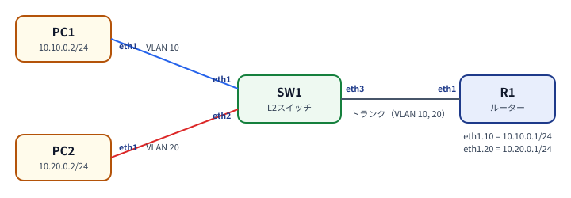
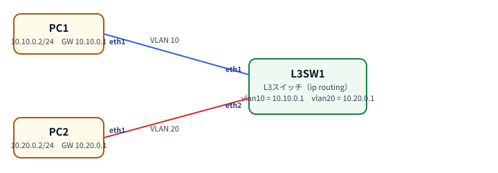
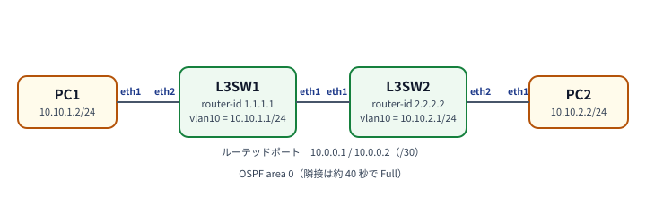

# 操作マニュアル（利用者編）
<!-- subtitle: ブラウザでネットワークを組んで、動かして、学ぶ -->

## 1. はじめに

### 1.1 このシステムでできること

Free-Networking-labs は、ブラウザの中でネットワークの演習環境を作れるシステムです。実機のルーターやスイッチを
用意しなくても、次のことができます。

- ルーター・L2スイッチ・**L3スイッチ**・PC を**ドラッグ＆ドロップで配置**し、線でつないでネットワーク図を作る
- 作った図をそのまま**起動**して、ブラウザの中のコンソールから設定する
- スイッチは **Cisco 風のコマンド**（`conf t`、`switchport mode access` など）で、ルーターは FRR の
  **vtysh**（Cisco 風のコマンド）で設定する
- VLAN、Router on a stick、STP（スパニングツリー）、EtherChannel、OSPF、BGP などの演習ができる。**L3スイッチ**では、VLAN 間ルーティング（SVI）、静的経路、OSPF・BGP・RIP、VRRP、DHCP リレー、ACL も使える
- 回線の**遅延・ロス・帯域**を変えたり、ケーブルを抜き差ししたりして、障害を再現できる
- 通信の中身を **Wireshark** でのぞける（パケットキャプチャ）
- 今の状態を**スナップショット**に残して、あとで戻したり、別のラボとして開いたりできる（12 章）
- ラボを**リンクで共有**したり、同じラボを複数の画面で一緒に編集したりできる（13 章）

図は自動で保存され、他の人のラボとは分かれています。サーバーに接続できる限り、自分の PC に何もインストール
せずに使えます。

| 機器 | 中身 | 設定のしかた |
|---|---|---|
| ルーター | FRR 10（オープンソースのルーティング・ソフトウェア） | コンソールで vtysh（Cisco 風の CLI） |
| L2スイッチ | Linux ブリッジ＋ Cisco 風 CLI（swcli）。VLAN・STP・EtherChannel 等に対応 | コンソールで Cisco 風の CLI |
| L3スイッチ | L2スイッチ＋ FRR。VLAN 間ルーティング・OSPF・BGP・VRRP・ACL 等に対応 | コンソールで Cisco 風の CLI（L2スイッチと同じ） |
| PC | 軽量な Linux（Alpine） | 画面でアドレスを入力。コンソールでは `ping`・`ip` 等 |

### 1.2 用意するもの

| 項目 | 内容 |
|---|---|
| アクセス先 | 管理者から案内された URL（例：`https://fnl.sotsuken.net/`） |
| アカウント | 管理者が作ったサーバーのアカウント（ユーザー名とパスワード）。持っていなければ管理者に依頼してください |
| ブラウザ | Chrome または Edge を推奨 |

!!! note "初めて開くときの警告"
    初回は「保護されていない通信」「この接続ではプライバシーが保護されません」のような警告が出ることがあります。
    このシステムの証明書は組織内で発行したもので、ブラウザが知らないためです。管理者から案内された URL であれば、
    「詳細設定」→「（URL）にアクセスする（安全ではありません）」で進んでください。許可は 1 回だけで済みます。

### 1.3 画面の構成

画面は大きく 3 つに分かれています。

| 画面 | 役割 |
|---|---|
| **ホーム** | 自分のラボの一覧。起動・停止・削除・エディタで開く、ができる |
| **トポロジエディタ** | ネットワーク図を描く画面。起動すると、ノードの状態（ランプ）が見える |
| **コンソール** | ノードの CLI をブラウザの中で操作する（エディタの右側または下に開く） |

画面上部の右にある 📊 では、画面下部に出すサーバーの使用状況（CPU・メモリ・ディスク）を選べます。🌙／☀️ で
ダーク／ライトを切り替えられます。みんなで 1 台のサーバーを共有しているので、使用率が高いとき（黄色や赤）は、
使い終わったラボを停止してください。

## 2. ログインとホーム

1. ログイン画面で、ユーザー名とパスワードを入力して「ログイン」を押します。
2. ホームが開き、自分のラボの一覧が出ます。他の人のラボは見えません。

ログインしたままブラウザを閉じても、しばらくは（約 24 時間）そのままログイン状態が続きます。期限が切れると
自動でログイン画面に戻ります。共用の PC では、使い終わったら右上の「ログアウト」を押してください。

ホームのラボカードには、状態（**未起動・起動中・停止中**）と、次のボタンがあります。

| ボタン | 動き |
|---|---|
| ▶ 起動 | ラボを起動します（初回は数十秒かかることがあります） |
| ■ 停止 | ラボ全体を停止します。**`write memory` していない設定は消えます**（6.4） |
| 削除 | ラボを削除します（保存した図と設定も消え、元に戻せません） |
| ✎ エディタで開く | トポロジエディタで図を開きます |
| ＋ 新規ラボを作成 | 新しい図を描き始めます |

## 3. ラボ（ネットワーク図）を作る

### 3.1 ノードを置く

1. ホームの「＋ 新規ラボを作成」を押します。エディタが開きます。
2. 左のパレットから、**ルーター・L2スイッチ・L3スイッチ・PC** をキャンバスにドラッグして置きます。L3スイッチの名前は `L3SW1` のようになります。
3. 置いたノードは、ドラッグで動かせます。右クリックで「名前を変更」「削除」などのメニューが出ます。

ラボ名（上部の入力欄）には、日本語も使えます。最初は「年月日時」（例：2026101512）が入っていて、そのままでも
書き換えてもかまいません。最初のノードを置いた時点で、その名前で保存されます。

!!! note "ラボ名とラボの ID"
    保存した後でも、ラボ名（表示名）はいつでも変えられます。画面に出る名前とは別に、システムの内部で使う
    「ラボの ID」があり、これは最初の保存で決まって変わりません（ID の先頭には自分のユーザー名が付きます）。
    入力欄にマウスを乗せると ID が見えます。自分のラボと同じ名前では、保存できません。

### 3.2 線でつなぐ

1. ノードの端から別のノードへドラッグします。
2. 「接続するインターフェースを選択」が開くので、両端のインターフェース（eth1、eth2 …）を選んで「接続」を
   押します。同じインターフェースは 2 回使えません。
3. PC につなぐときは、この画面で **IP アドレス**（例：`10.0.0.2/24`）と**デフォルトゲートウェイ**
   （例：`10.0.0.1`）も入力できます。ルーター側の入力欄はありません（ルーターはコンソールで設定します）。
4. 線を右クリックすると、設定の編集、接続の解除、リンクの品質（8 章）、ケーブルの抜き差し、パケット
   キャプチャ（9 章）ができます。

### 3.3 自動保存と「元に戻す」

保存ボタンはありません。編集すると 1 秒ほどで**自動で保存**され、上部に「保存済み」と出ます。

- **Ctrl+Z**（または ↶ ボタン）で 1 つ前に戻り、**Ctrl+Shift+Z**（または ↷ ボタン）でやり直せます。
- 戻す・やり直すと、「何がどう変わったか」が画面上部に数秒表示されます（例：「PC「pc-1」を削除」）。
- 履歴は、エディタを開いている間だけ残ります。
- 手元にも控えを持ちたいときは、「エクスポート」（11 章）を使います。

## 4. 起動と停止

### 4.1 起動する

エディタ上部の「**▶ 起動**」（またはホームの「▶ 起動」）を押すと、ラボが起動します。ノードの右上にランプが出ます。

| ランプ | 意味 |
|---|---|
| 緑 | 起動中 |
| 灰（ノードも薄く点線） | 停止中 |
| 黄の点滅 | 起動・停止の処理中 |
| 黄の枠 | 起動中のラボに追加したばかりで、まだ反映されていない |

### 4.2 起動したまま編集する

起動中に、ノードや線を追加・削除しても、**変更した部分だけ**が反映されます。変更していないノードは作り直されず、
中の設定もコンソールもそのまま残ります。「動いているラボに反映中...」→「保存・反映済み」と表示されます。

### 4.3 ノードごとの停止・起動

ノードを右クリックして「ノードを停止」「ノードを起動」を選ぶと、そのノードだけを止めたり、起動したりできます
（線はつながったままです）。故障の演習などに便利です。一部だけ止めると、上部が「● 起動中（3/4）」のようになります。

!!! warning "停止すると、保存していない設定は消えます"
    ノードやラボを停止すると、実機の電源を切ったのと同じ扱いになり、`write memory` していない設定は消えます
    （6.4）。PC のアドレスは、起動のたびに自動で入り直すので消えません。

### 4.4 ラボを停止・削除する

使い終わったラボは、ホームで「■ 停止」を押してください。長く使わないラボは「削除」で片付けると、サーバーの
メモリとディスクが空きます。

## 5. コンソールを使う

起動中のノードを右クリックして「**コンソールを開く**」を選ぶと、ブラウザの中にターミナルが開きます。
複数のノードのコンソールは、タブで切り替えられます。パネルを閉じると、すべてのコンソールが終了します。

| ノード | コンソールで動くもの |
|---|---|
| ルーター | vtysh（Cisco 風の CLI）。`exit` や Ctrl+D で終了しても、すぐ起動し直されます |
| L2スイッチ | Cisco 風の CLI（プロンプトは `sw#` など）。シェルには落ちません |
| L3スイッチ | L2スイッチと同じ Cisco 風の CLI（`ip routing` や `router ospf` なども打てる） |
| PC | シェル（`ping`、`ip a`、`ip route`、`traceroute` など） |

!!! note "コンソールの表示は英語です"
    スイッチ・ルーターの出力は英語で、実機の Cisco と同じ書式を目指しています。

## 6. 機器を設定する

どこで何を設定するかは、機器ごとに決まっています。

| 機器 | 設定する場所 |
|---|---|
| PC | 画面（接続のダイアログ）。線を右クリック →「設定を編集」で、後から変更もできます |
| ルーター | コンソール（vtysh）。アドレス・ルーティング・サブインターフェースのすべて |
| L2スイッチ | コンソール（Cisco 風 CLI）。VLAN・トランク・STP など |
| L3スイッチ | コンソール（Cisco 風 CLI）。L2スイッチの設定に加えて、ルーティング・VRRP・ACL など（6.5） |

### 6.1 PC の IP アドレス

線を作るときのダイアログ、または線を右クリック →「設定を編集」で、IP アドレス（`10.0.0.2/24` の形式）と
ゲートウェイを入力します。起動中に変えると、すぐ反映されます。PC のコンソールで確認できます。

```
ip a
ip route
ping 10.0.0.1
```

### 6.2 ルーター（FRR / vtysh）

ルーターのコンソールは vtysh です。Cisco の IOS とほぼ同じ書式で、`conf t`、`int eth1`、`ip add ...`、`end`、
`sh run`、`wr` などと打てます（省略形も使えます）。

```
conf t
hostname R1
int eth1
 ip add 10.0.0.1/24
 no shutdown
end
sh int brief
sh run
wr
```

- **サブインターフェース**（VLAN 用）は、`int eth1.10` のように打つだけで自動で作られます（VLAN ID は
  名前の「.」の後ろ）。消すときは `no interface` ではなく、`no ip add ...` で設定を空にします
  （FRR の仕様で、動いているインターフェースは `no interface` で消せません）。
- **BGP の注意**：eBGP のネイバー間にルートポリシー（route-map など）が無いと、ネイバーが Established に
  なっても経路が送受信されません（FRR の仕様）。経路が来ないときは、まずポリシーを確認してください。
  検証だけなら `no bgp ebgp-requires-policy` で外せます。
- ルーターでは LLDP/CDP の近隣を見るコマンドはありません（スイッチ側から見ます）。

### 6.3 L2スイッチ（Cisco 風 CLI）

スイッチのコンソールでは、Cisco とほぼ同じ操作ができます。

- **省略形**：`conf t`、`int e1`、`sw mo acc`、`sh vl br` のように、一意に決まる範囲で省略できます。
- **`?`**：打った瞬間に、次の候補と説明が出ます（`sw ?`）。
- **Tab**：補完します。候補が複数あれば、一覧が出ます。
- **エラー**：間違えた位置に `^` が出て、`% Invalid input detected at '^' marker.` と表示されます。
- **Ctrl+Z**：特権モード（`#`）に戻ります。
- **`do`**：設定モードのまま、`do show ...` のように表示系のコマンドを実行できます。
- **出力の絞り込み**：`show running-config | include vlan` のように `| include / exclude / begin / section`。

基本の設定は次のとおりです。

```
sw#conf t
sw(config)#vlan 10
sw(config-vlan)# name Sales
sw(config-vlan)#int eth1
sw(config-if)# switchport mode access
sw(config-if)# switchport access vlan 10
sw(config-if)#int eth3
sw(config-if)# switchport mode trunk
sw(config-if)# switchport trunk allowed vlan 10,20
sw(config-if)#end
sw#show vlan brief
sw#write memory
```

スイッチの設定の様子は、`show vlan brief`、`show interfaces status`、`show interfaces trunk`、
`show mac address-table`、`show running-config` で確認します。コマンドの一覧は付録 A を見てください。

!!! note "Cisco との違い"
    何も設定していないポートは、VLAN 1 のアクセスポートです。トランクの native VLAN（既定は VLAN 1）は
    タグなしで流れます。PVST（VLAN ごとの STP）、PAgP、DHCP スヌーピング、SPAN はありません。

### 6.4 設定の保存（write memory）

ルーターとスイッチ（L2・L3）の設定は**自動では保存されません**。残したいときは、実機と同じく `write memory`
（または `wr`）を実行します。

| 操作 | `write memory` した設定 | しなかった設定 |
|---|---|---|
| ノード・ラボの停止 → 起動 | 残る | **消える** |
| ラボの「作り直す」 | 残る | 消える |
| 起動中の図の編集 | 残る | 残る（編集しただけでは消えない） |
| ラボの削除 | 消える | 消える |

PC のアドレスは、画面で入力した値が起動のたびに自動で入り直すので、`write memory` は要りません。

### 6.5 L3スイッチ（Cisco 風 CLI）

L3スイッチは、L2スイッチ（6.3）の機能に、**ルーティング**を足したものです。VLAN・トランク・STP・EtherChannel などの
コマンドは、L2スイッチと同じに使えます。経路の計算は、ルーターと同じ FRR が受け持ちます。

実機の Catalyst と同じく、**`ip routing` を入れるまでは L3 として動きません**（既定は `no ip routing`）。
その間は、VLAN をまたぐ通信が止まり、`router ospf` などのコマンドも使えません。

| やりたいこと | コマンド |
|---|---|
| ルーティングを動かす／止める | `ip routing` ／ `no ip routing`（止めても、設定は残ります） |
| VLAN にアドレスを付ける（SVI） | `interface vlan 10` → `ip address 10.10.0.1 255.255.255.0` → `no shutdown` |
| 静的経路 | `ip route 10.99.0.0 255.255.255.0 10.0.0.2` ／ `no ip route …` |
| ポートをルーテッドポートにする | `interface eth3` → `no switchport` → `ip address 10.0.0.1 255.255.255.252`（`switchport` で戻すとアドレスは消えます） |
| 経路表を見る | `show ip route`（`show ip route ospf` のように絞り込めます） |
| OSPF | `router ospf 1`（中で `router-id`、`network 10.0.0.0 0.0.0.3 area 0`、`passive-interface vlan 10`）、`show ip ospf neighbor` |
| BGP | `router bgp 65001`（中で `neighbor`、`network … mask …`、`address-family ipv4`）、`show ip bgp summary` |
| RIP | `router rip`（中で `version 2`、`network 10.0.0.0`） |
| 経路のフィルタ | `ip prefix-list`、`route-map NAME permit 10`（中で `match`・`set`）、`ip as-path`、`ip community-list` |
| 冗長化（VRRP） | `interface vlan 10` の中で `vrrp 1 ip 10.10.0.1`、`vrrp 1 priority 120`、`show vrrp` |
| DHCP リレー | `interface vlan 10` の中で `ip helper-address 10.0.0.5` |
| アクセス制限（ACL） | `ip access-list extended NAME`、`ip access-group NAME in`、`show access-lists` |

コマンドの一覧は付録 C を見てください。

!!! note "FRR の部分（router の中など）の使い方"
    `router ospf` や `route-map` の中のコマンドは、FRR にそのまま渡されます。Cisco の書き方（`network … 0.0.0.3 area 0` の
    ワイルドカードマスク、`network … mask …` など）は、自動で FRR の書き方に直されます。
    ただし、**`?` のヘルプと Tab 補完は、この部分では効きません**。間違えると FRR のエラーが出ます。
    `show running-config` では、Cisco の書き方に戻して表示します。

!!! note "Cisco との違い"
    - **`ip routing` の直後**は、ルーティングの部品が起動するまで数秒かかります。その間に打ったコマンドは、
      最大 10 秒待ってから処理されます。
    - SVI のアドレスは、打ってから 1 秒ほどで反映されます。続けて貼り付けると、`vrrp 1 ip` などが「アドレスがない」と
      断られることがあるので、少し間をあけてください。
    - **BGP の `ebgp-requires-policy`**：eBGP で経路を受け渡すには、`router bgp` の中で `no bgp ebgp-requires-policy` を
      入れます（FRR の仕様で、ルーターと同じです）。
    - OSPF の隣接は、起動してから**約 40 秒**でできます（hello 10 秒・dead 40 秒）。
    - **VRRP の版**は、既定が 3 です。`vrrp 1 version 2` で版 2 にできますが、**両方のスイッチで版をそろえてください**
      （食い違うと、両方が Master になります）。切り替えには、約 4 秒かかります。
    - VRRP を入れた SVI を `shutdown` すると、そのスイッチの `show vrrp` は Master のままに見えます（表示だけで、もう一方が
      引き継ぐので通信には影響しません。`no shutdown` で正しい状態に戻ります）。
    - ACL は IPv4 だけです。`log`、VTY の `access-class`、時間指定、オブジェクトグループはありません。

## 7. 演習の例

次の例は、このシステムで実際に動かして、結果を確認した手順です（7.3・7.4 は、動作の確認結果をテスト記録に残しています）。図を作って起動したら、コンソールで入力してください。

### 7.1 VLAN でネットワークを分ける

**図**：PC1 と PC2 と PC3 を、1 台のスイッチ（SW1）につなぎます。

| 接続 | PC のアドレス |
|---|---|
| PC1 — SW1 eth1 | 10.0.0.1/24 |
| PC2 — SW1 eth2 | 10.0.0.2/24 |
| PC3 — SW1 eth3 | 10.0.0.3/24 |

SW1 のコンソールで、PC1・PC2 を VLAN 10、PC3 を VLAN 20 にします。

```
conf t
interface range eth1-2
 switchport mode access
 switchport access vlan 10
interface eth3
 switchport mode access
 switchport access vlan 20
end
show vlan brief
```

PC1 のコンソールで `ping 10.0.0.2` は**通り**、`ping 10.0.0.3` は**通りません**。VLAN が違うためです。

### 7.2 Router on a stick（VLAN 間ルーティング）

**図**：PC1（VLAN 10）と PC2（VLAN 20）を SW1 につなぎ、ルーター R1 を SW1 のトランクにつなぎます。



| 接続 | アドレス |
|---|---|
| PC1 — SW1 eth1 | 10.10.0.2/24、ゲートウェイ 10.10.0.1 |
| PC2 — SW1 eth2 | 10.20.0.2/24、ゲートウェイ 10.20.0.1 |
| R1 eth1 — SW1 eth3 | （R1 のコンソールで設定） |

**SW1**

```
conf t
int eth1
 switchport mode access
 switchport access vlan 10
int eth2
 switchport mode access
 switchport access vlan 20
int eth3
 switchport mode trunk
 switchport trunk allowed vlan 10,20
end
wr
```

**R1**

```
conf t
int eth1.10
 ip add 10.10.0.1/24
int eth1.20
 ip add 10.20.0.1/24
end
wr
```

1 秒ほどでサブインターフェースが作られます。PC1 から `ping 10.20.0.2` が、ルーターを経由して通ります。

### 7.3 スパニングツリー（STP）でループを防ぐ

**図**：SW1・SW2・SW3 を三角形につなぎ（ループ）、SW1 と SW3 に PC を 1 台ずつつなぎます。

スイッチは最初から **rapid-stp**（802.1w）で動いているので、ループを組んでも通信できます。
`show spanning-tree` で、ルートブリッジと各ポートの役割（Role）と状態（FWD/BLK）を見ます。

```
show spanning-tree
conf t
spanning-tree vlan 1 root primary     ← このスイッチをルートにする
int eth3
 spanning-tree portfast               ← PC をつなぐポートはすぐ転送する
 spanning-tree bpduguard enable       ← BPDU を受けたら err-disabled にする
end
```

- どれか 1 つのポートが `Altn BLK`（代替・ブロック）になります。
- 通信中の経路の線を右クリック →「ケーブルを抜く」（8 章）と、迂回路で通信が戻ります。`rapid-stp` は、ポートを `shutdown` したときも、ほとんど止まらずに切り替わります。
- `spanning-tree mode stp` で全スイッチを古典 STP（802.1D）に変えて同じことをすると、迂回に約 50 秒かかります。
  RSTP との差を体験できます。
- PC をつなぐポートに `portfast` が無いと、リンクが上がってから約 30 秒待ちます（Cisco と同じです）。
- モードは `stp`・`rapid-stp`・`mstp` の 3 つです。MSTP は VLAN ごとに別のツリーを作れます。

### 7.4 EtherChannel（LACP）で回線を束ねる

**図**：SW1 と SW2 を 2 本の線でつなぎ（eth2、eth3）、それぞれに PC を 1 台つなぎます。

両方のスイッチで、同じ設定を入れます（片方は `passive` でもかまいません）。

```
conf t
interface range eth2-3
 switchport mode trunk
 channel-group 1 mode active
end
show etherchannel summary
show lacp neighbor
show spanning-tree
```

- `Po1(SU)` と、メンバーの `eth2(P) eth3(P)` が出ます。STP には、eth2/eth3 ではなく `Po1` が 1 本だけ出ます。
- 線の 1 本を右クリック →「ケーブルを抜く」しても、PC 間の `ping` は止まりません。`eth2(D)` と表示されます。
- 使えるのは `active`・`passive`（LACP）と `on`（固定）です。PAgP（`desirable`/`auto`）には対応していません。

### 7.5 OSPF で経路を学習する

**図**：ルーター R1 と R2 をつなぎ、それぞれの先に PC をつなぎます。

| 線 | アドレス |
|---|---|
| R1 eth1 — R2 eth1 | 10.0.12.1/24 と 10.0.12.2/24 |
| R1 eth2 — PC1 | 10.0.1.1/24（PC1 は 10.0.1.2、ゲートウェイ 10.0.1.1） |
| R2 eth2 — PC2 | 10.0.2.1/24（PC2 は 10.0.2.2、ゲートウェイ 10.0.2.1） |

**R1**（R2 も、自分のアドレスに読み替えて同じように設定します）

```
conf t
int eth1
 ip add 10.0.12.1/24
int eth2
 ip add 10.0.1.1/24
router ospf
 network 10.0.12.0/24 area 0
 network 10.0.1.0/24 area 0
end
show ip ospf neighbor
show ip route
wr
```

隣接関係ができて（`show ip ospf neighbor` が `Full`）、PC1 から PC2 に `ping` が通ります。`show ip route` に、相手側のネットワークが `O`（OSPF）として出ます。

### 7.6 L3スイッチで VLAN 間ルーティング（SVI）

**図**：L3スイッチ L3SW1 に、PC1（eth1）と PC2（eth2）をつなぎます。PC1 は 10.10.0.2/24（ゲートウェイ 10.10.0.1）、
PC2 は 10.20.0.2/24（ゲートウェイ 10.20.0.1）にします。



**L3SW1**

```
conf t
vlan 10
vlan 20
int eth1
 switchport mode access
 switchport access vlan 10
int eth2
 switchport mode access
 switchport access vlan 20
int vlan 10
 ip address 10.10.0.1 255.255.255.0
 no shutdown
int vlan 20
 ip address 10.20.0.1 255.255.255.0
 no shutdown
end
wr
```

この時点では、PC1 から ゲートウェイ（10.10.0.1）へは `ping` が通りますが、**PC2 へは通りません**（`ip routing` がないため）。
続けて入れます。

```
conf t
ip routing
end
show ip route
```

数秒で PC1 から PC2 に `ping` が通ります。`show ip route` に、`C`（直結）の経路として 10.10.0.0/24 と 10.20.0.0/24 が出ます
（管理用の `eth0` の経路も出ますが、無視してかまいません）。`no ip routing` に戻すと、また止まります。

### 7.7 L3スイッチ 2 台で OSPF

**図**：L3SW1 の eth1 と L3SW2 の eth1 をつなぎ（ルーテッドポート、10.0.0.0/30）、それぞれの eth2 に PC をつなぎます
（VLAN 10：10.10.1.0/24 と 10.10.2.0/24）。



**L3SW1**（L3SW2 は、アドレスと `router-id` を読み替えます）

```
conf t
ip routing
vlan 10
int eth2
 switchport mode access
 switchport access vlan 10
int vlan 10
 ip address 10.10.1.1 255.255.255.0
 no shutdown
int eth1
 no switchport
 ip address 10.0.0.1 255.255.255.252
router ospf 1
 router-id 1.1.1.1
 network 10.0.0.0 0.0.0.3 area 0
 network 10.10.1.0 0.0.0.255 area 0
 passive-interface vlan 10
end
wr
```

約 40 秒で `show ip ospf neighbor` が `Full` になり、`show ip route` に相手側のネットワークが `O` で出ます。PC どうしの `ping` が通ります。
設定を `write memory` しておけば、停止→起動しても OSPF は戻ります。

!!! note "network 文のマスクは「ワイルドカード」"
    Cisco と同じく、`network 10.0.0.0 0.0.0.3 area 0` の 2 つ目は**ワイルドカードマスク**（サブネットマスクの逆）です。
    連続しないワイルドカードは受け付けません。

### 7.8 eBGP と route-map

**図**：L3SW1（AS 65001）と L3SW2（AS 65002）を、7.7 と同じルーテッドポート（10.0.0.1 と 10.0.0.2）でつなぎます。
L3SW1 には、広告するネットワークが 2 つあります（10.10.1.0/24 と 10.20.1.0/24）。

**L3SW1**

```
conf t
router bgp 65001
 bgp router-id 1.1.1.1
 no bgp ebgp-requires-policy
 neighbor 10.0.0.2 remote-as 65002
 address-family ipv4
  network 10.10.1.0 mask 255.255.255.0
  network 10.20.1.0 mask 255.255.255.0
  neighbor 10.0.0.2 activate
 exit-address-family
end
```

**L3SW2**（10.10.0.0/16 の範囲だけを受け入れ、優先度を上げます）

```
conf t
ip prefix-list ONLY10 seq 5 permit 10.10.0.0/16 le 24
route-map IN permit 10
 match ip address prefix-list ONLY10
 set local-preference 200
exit
router bgp 65002
 bgp router-id 2.2.2.2
 no bgp ebgp-requires-policy
 neighbor 10.0.0.1 remote-as 65001
 address-family ipv4
  neighbor 10.0.0.1 route-map IN in
  neighbor 10.0.0.1 activate
 exit-address-family
end
show ip bgp summary
show ip bgp
```

`show ip bgp` に、**10.10.1.0/24 だけ**が優先度（LocPrf）200 で出ます。10.20.1.0/24 は、route-map で許可されていないので入りません。

### 7.9 ACL でアクセスを制限する

7.6 の図（PC1 は VLAN 10、PC2 は VLAN 20）で、**PC1 から PC2 への `ping` だけ**と、TCP の 8080 番を止めます。

```
conf t
ip access-list extended BLOCK
 deny icmp host 10.10.0.2 host 10.20.0.2 echo
 deny tcp any any eq 8080
 permit ip any any
 exit
interface vlan 10
 ip access-group BLOCK in
end
show access-lists
```

PC1 から PC2 への `ping` が通らなくなります（逆向きは通ります）。ゲートウェイへの `ping` や、8080 以外の TCP は通ります。
`show access-lists` には、止めた回数が `(N matches)` で出ます。外すときは、`interface vlan 10` の中で `no ip access-group BLOCK in` です。

!!! warning "ACL の最後は「すべて拒否」"
    Cisco と同じく、ACL の最後には見えない `deny ip any any` があります。上の例の `permit ip any any` を忘れると、
    それ以外の通信（ゲートウェイへの `ping` や、OSPF のメッセージも）が止まります。

標準 ACL（`access-list 10 permit 10.10.0.0 0.0.0.255`）は、BGP の `route-map` の `match ip address 10` でも使えます。

### 7.10 VRRP でゲートウェイを冗長化する

**図**：L3SW1 と L3SW2 を、同じ VLAN 10 のアクセスポートでつなぎ（eth1 どうし）、PC のゲートウェイを仮想アドレス 10.10.0.1 にします。

**L3SW1**（優先度を高くします）

```
conf t
ip routing
vlan 10
int eth1
 switchport mode access
 switchport access vlan 10
int vlan 10
 ip address 10.10.0.2 255.255.255.0
 no shutdown
end
conf t
int vlan 10
 vrrp 1 ip 10.10.0.1
 vrrp 1 priority 120
end
```

**L3SW2** は、`ip address 10.10.0.3 255.255.255.0` にして、`vrrp 1 ip 10.10.0.1` だけを入れます（優先度は既定の 100）。

`show vrrp` で、L3SW1 が `Master`、L3SW2 が `Backup` になります。PC から 10.10.0.1 に `ping` が通ります。
L3SW1 を停止すると、数秒で L3SW2 が `Master` になり、`ping` が続きます。

### 7.11 DHCP リレーで別のネットワークの DHCP サーバーを使う

VLAN 10 の PC に、ルーテッドポートの先にある DHCP サーバー（10.0.0.5 とします）からアドレスを配ります。

```
conf t
interface vlan 10
 ip address 10.10.1.1 255.255.255.0
 ip helper-address 10.0.0.5
end
```

VLAN 10 の PC が出した DHCP の要求が、サーバーに中継されます。サーバーには、10.10.1.0/24 のアドレス範囲と、
このスイッチ（10.10.1.1）への戻り経路が必要です。

## 8. リンクの品質とケーブルの抜き差し

線は、何も設定しなければ**帯域 100 Mbps**です。線を右クリックすると、次のメニューが出ます。

- **リンクの品質...**：帯域・遅延・ゆらぎ・パケットロス・パケット破損を設定します。
- **ケーブルを抜く／差す**：物理的な断線を再現します。

「リンクの品質...」には、「海外回線」「衛星回線」「不安定な無線」などのボタンがあり、値をまとめて入れられます。
変更は自動で保存され、動いているラボにはすぐ反映されます。

| 項目 | 意味・例 |
|---|---|
| 帯域 | 通信速度の上限。既定 100 Mbps。「無制限」も選べます（約 8 Gbps まで出るため、大量に流すとサーバーが重くなります） |
| 遅延 | 片道の遅れ（ms）。**50 ms なら往復で約 100 ms** になります |
| ゆらぎ | 遅延のばらつき（±ms）。遅延を設定したときだけ使えます |
| パケットロス | 失われる割合（%） |
| パケット破損 | 壊れる割合（%） |

- 品質を設定した線は**紫**になり、ラベルに内容（例：`10Mbps・50ms`）が出ます。「既定に戻す」で灰色に戻ります。
- ケーブルを抜いた線は**赤の破線**になり、「✕ 切断」と出ます。スイッチでは `notconnect` になります
  （`shutdown` したときの `disabled` とは区別されます）。
- 品質を設定しても、STP のコスト（`show spanning-tree` の Cost）は変わりません。必要なら `spanning-tree cost` で
  指定します。
- 品質とケーブルの状態は、ノードを停止→起動しても、自動で入り直します。

## 9. パケットキャプチャ（Wireshark）

1. ラボを起動した状態で、**線を右クリック →「パケットキャプチャ」**を選びます。
2. 新しいタブに Wireshark が開きます（数秒〜数十秒かかり、最初のときは少し長くかかります）。
3. PC で `ping` などを打つと、パケットが流れて見えます。

- タブの名前は「R1(eth1) ↔ SW1」のように、どこをキャプチャしているかを示します。
- 線の両端のノードそれぞれでキャプチャでき、スイッチ側のポートでも取れます。
- Wireshark で右クリック → Copy したものは、そのまま `Ctrl+V` で貼れます。貼れないときは、画面左端の矢印から
  クリップボード欄を開いてください。
- **タブを閉じる**と、1 分ほどで Wireshark の裏の仕組みも自動で片付きます。
- ラボが起動していないと、押せません。1 回のキャプチャは、始めてから約 2 時間で自動的に終了します（サーバーの既定の設定）。

## 10. ノードを初期状態に戻す（wipe）

ノードを右クリックして「**初期状態に戻す（wipe）**」を選ぶと、そのノードの設定を**すべて消し**、
作り直します（`write memory` した設定も消えます）。確認のダイアログが出ます。
ほかのノードと線はそのままです。「設定を最初からやり直したい」「何をしたか分からなくなった」ときに使います。

- ルーターは最初の状態（ホスト名だけ）に、スイッチは設定のない状態に戻ります。
- 隣のノードの設定（PC のアドレスなど）は、自動で入り直します。
- 数十秒かかることがあります。

## 11. エクスポートとインポート

| 操作 | 使い方 |
|---|---|
| **エクスポート** | 保存済みのラボのエディタで「エクスポート」を押すと、図の定義（YAML）と配置の情報がダウンロードされます |
| **インポート** | 新規ラボの画面で「インポート」を押し、他の人（や、前に自分が）エクスポートしたファイルを選ぶと、そのラボを読み込んで編集を始められます |

課題の雛形を配るときや、ラボのバックアップに使えます。`.yml` / `.yaml` 以外のファイルは読み込めません。
保存済みのラボを開いている間は、上書きを防ぐため、インポートは押せません。

## 12. スナップショット（状態を保存して戻す）

エディタ上部の「**スナップショット**」を押すと、今のラボの状態を残したり、あとで戻したりできます。
「課題の前に戻りたい」「設定を大きく変える前に取っておきたい」ときに使います。

| 保存されるもの | 保存されないもの |
|---|---|
| ノードと線の図（配置を含む） | MAC アドレステーブル、OSPF の隣接などの**動いている状態**（戻したあとに作り直されます） |
| ルーター・スイッチ（L2・L3）の設定（`write memory` したのと同じ内容。**動いているノードだけ**） | PC に手で入れた設定（`ip addr add` など） |

- **今の状態を保存**：名前とメモ（どちらも省略できます）を入れて保存します。ラボが**停止中**だと、設定は読めないので、図だけが保存されます
  （一覧に「取れなかった」ノードが出ます）。
- **戻す**：確認のあとで、図を置き換え、保存した設定を書き戻してノードを再起動します（動いていなければラボを起動します）。
  戻す前の状態は、「自動」のスナップショットとして残るので、**戻しすぎても元に戻せます**。数十秒かかることがあります。
- **削除**：不要なものを消します。1 つのラボに**20 個**まで残せます（自動のものは、古い順に消えます）。
- **別のラボとして開く**：元のラボはそのままに、「〇〇のコピー」という新しいラボを作って開きます。設定があれば、起動して設定を戻します。
  「元のラボを壊さずに試したい」ときに使います。
- **書き出し・ファイルから取り込む**：スナップショットを 1 つの JSON ファイルに書き出せます。別のラボ（や別のユーザー）で
  「ファイルから取り込む」と、そのラボのスナップショットになり、「戻す」で使えます。課題の初期状態を配るときに便利です。

ホームのラボ一覧にはスナップショットは出ません。元のラボを削除すると、スナップショットも消えます。
共有リンクで開いた他人のラボには、スナップショットのボタンは出ません。

## 13. 共有リンクと、複数の画面での編集

### 13.1 ラボを共有する

エディタ上部の「**共有**」を押すと、このラボを**リンクを知っている人**と共有できます。

| 権限 | できること |
|---|---|
| 閲覧のみ | 図と、ノードの状態を見るだけ |
| 編集も可 | 図の編集、ノードの起動・停止、**ノードのコンソールの操作**ができる |

- リンクを開く人も、**自分のアカウントでログイン**する必要があります。
- 期限は**最長 8 時間**で、あなたのログインが切れると無効になります。「取り消す」でいつでも止められます。
- 「編集も可」のリンクを開いた人は、あなたのノードで**コマンドを実行**できます。信頼できる相手にだけ渡してください。

### 13.2 同じラボを複数の画面で開く

同じラボを、複数のタブや別の PC で開いても大丈夫です。

- 一方で保存した変更は、**1 秒ほど**でもう一方にも出ます。
- 両方で編集して、**別々の場所**（別のノードを動かした、別の機器を足した、など）を変えた場合は、**自動で合わせて**
  取り込まれます（上部に「別の画面の変更を、自分の編集と合わせて取り込みました」と出ます）。
- **同じ場所**を両方が変えた場合は、**自分の内容が残り**、「同じ所を両方が変えた所は自分の内容を残しました」と、その場所が出ます。
- 自動では決められないとき（同じインターフェースに別々の線をつないだ、同じ名前のノードを別々に足した）は、
  保存が止まり、「**最新を読み込む**」（自分の編集を捨てる）か「**自分の内容で上書き**」を選びます。

!!! note "元に戻す履歴"
    別の画面の変更を取り込むと、「元に戻す／やり直す」の履歴は空になります。

## 14. 困ったとき

| 症状 | 確認すること |
|---|---|
| ログインできない | ユーザー名・パスワードを確認。短い時間に何度も失敗すると、一時的に受け付けなくなることがあります（少し待ってからやり直してください）。解決しなければ管理者に連絡 |
| 「起動」が終わらない | 初回は数十秒かかります。1 分以上たつときは、サーバーの使用状況（画面下部）が高くないか確認 |
| 設定が消えた | 停止や作り直しの前に `write memory` をしたか（6.4）。PC のアドレスは自動で戻ります |
| `ping` が通らない | ① 両端のアドレスとマスクが合っているか ② PC にデフォルトゲートウェイがあるか ③ スイッチの VLAN が合っているか（`show vlan brief`、`show interfaces trunk`）④ ケーブルを抜いた状態（赤い破線）になっていないか ⑤ ポートが `shutdown` や `err-disabled` になっていないか（`show interfaces status`） |
| ルーターのサブインターフェースが通らない | VLAN 1 は native VLAN でタグなしです。VLAN 1 は物理インターフェース（eth1）にアドレスを付けるか、スイッチ側で `switchport trunk native vlan 999` のように native VLAN を変えます |
| BGP で経路が来ない | `ebgp-requires-policy`（6.2）を確認 |
| L3スイッチで VLAN をまたぐと通らない | `ip routing` が入っているか（`show running-config`）。SVI が `no shutdown` か、PC のゲートウェイが SVI のアドレスか。ポートが転送状態になるまで数秒かかる（`show spanning-tree`） |
| `% IP routing not enabled` と出る | `router ospf`・`route-map`・`show ip ospf` などは、`ip routing` を入れてから使えます（6.5） |
| OSPF の隣接ができない | 両端のアドレスとマスク、`network` の**ワイルドカード**、SVI の `no shutdown`、`passive-interface` の付けすぎを確認。できるまで約 40 秒かかります |
| ACL を入れたら通信が全部止まった | ACL の最後は見えない `deny ip any any` です。`permit ip any any` を足すか、`no ip access-group` で外します（7.9） |
| 「古い形式のラボ」と出る | 古い版で作ったラボです。「作り直す」を押すと、今の形式で起動し直します（`write memory` していない設定は消えます） |
| 画面の動きがおかしい | ブラウザを再読み込み（F5）。ラボの内容は、保存されています |
| 見つけた不具合を知らせたい | ①何をしたか ②期待したこと ③実際に起きたこと（エラーの文はそのまま）④時刻、を管理者に伝えてください（スクリーンショット歓迎） |

## 付録 A　スイッチ（Cisco 風 CLI）のコマンド一覧

### 表示系（特権モード）

| コマンド | 内容 |
|---|---|
| `show running-config` / `show startup-config` | 設定 |
| `show vlan [brief]` | VLAN の一覧 |
| `show interfaces [ethN]` | インターフェースの詳細（状態・MAC・BW・送受信レート・カウンタ） |
| `show interfaces status` / `show interfaces trunk` | ポートの状態／トランクの情報 |
| `show interfaces counters` / `clear counters [ethN]` | カウンタの表示／クリア |
| `show ip interface brief` | IP インターフェースの要約 |
| `show mac address-table [dynamic｜static] [address M｜interface X｜vlan N] [count]` | MAC アドレステーブル |
| `clear mac address-table dynamic [...]` | 学習した MAC を消す |
| `show spanning-tree` / `show spanning-tree mst [N]` / `show spanning-tree mst configuration` | STP の状態 |
| `show etherchannel summary` / `show lacp neighbor` | EtherChannel |
| `show lldp [neighbors [detail]]` / `show cdp [neighbors [detail]]` | 近隣機器 |
| `show port-security [interface X｜address]` | ポートセキュリティ |
| `show logging` / `clear logging` | ログ |
| `ping A [repeat N｜size N]` | 疎通確認（SVI に IP を付けたとき） |
| `write [memory]` / `copy running-config startup-config` | 設定の保存 |

### 設定（`conf t` の中）

| 分類 | コマンド |
|---|---|
| 全般 | `hostname`、`vlan <list>`・`name`、`do ...`、`end`、`exit`、`no ...` |
| ポート | `interface ethN`、`interface range eth1-3,eth5`、`interface port-channel N`、`shutdown`、`description` |
| VLAN | `switchport mode access/trunk`、`switchport access vlan N`、`switchport trunk allowed vlan <list>/add/remove/all/none`、`switchport trunk native vlan N` |
| STP | `spanning-tree mode stp/rapid-stp/mstp`、`spanning-tree vlan <list> root primary/secondary`・`priority N`、`spanning-tree portfast`、`spanning-tree bpduguard enable`、`spanning-tree bpdufilter enable`、`spanning-tree guard root`、`spanning-tree cost N`、`spanning-tree port-priority N`、`spanning-tree mst configuration`（`name`・`revision`・`instance N vlan <list>`） |
| EtherChannel | `channel-group N mode active/passive/on` |
| MAC | `mac address-table aging-time N`、`mac address-table static M vlan N interface X` |
| 管理用 IP（SVI） | `interface vlan N`（`ip address A M`、`no shutdown`）、`ip default-gateway A` |
| パスワード | `enable secret`、`enable password`、`service password-encryption`、`line con 0`（`password`、`login`） |
| 近隣探索 | `lldp run`、`cdp run`（既定は CDP が有効、LLDP が無効）、`no cdp enable`、`lldp transmit/receive` |
| ポートセキュリティ | `switchport port-security`、`... maximum N`、`... violation protect/restrict/shutdown`、`... mac-address [sticky] [M]` |
| ログ | `logging console`（ログをコンソールに流す） |

## 付録 B　ルーター（vtysh）でよく使うコマンド

| コマンド | 内容 |
|---|---|
| `show running-config`（`sh run`） | 設定 |
| `show interface brief`（`sh int brief`） | インターフェースの一覧 |
| `show ip route` | ルーティングテーブル |
| `show ip ospf neighbor` / `show ip ospf database` | OSPF の隣接とデータベース |
| `show bgp summary` / `show ip bgp` | BGP の状態 |
| `conf t` → `int ethN` → `ip add A/N` → `no shutdown` | アドレスの設定 |
| `conf t` → `ip route 宛先/長さ 次のホップ` | スタティックルート |
| `conf t` → `router ospf` → `network A/N area 0` | OSPF |
| `conf t` → `router bgp ASN` → `neighbor A remote-as ASN` | BGP |
| `write memory`（`wr`） | 設定を保存 |

## 付録 C　L3スイッチ（Cisco 風 CLI）のコマンド一覧

L2スイッチのコマンド（付録 A）に加えて、次のコマンドが使えます。

### 表示系（特権モード）

| コマンド | 内容 |
|---|---|
| `show ip route [ospf｜bgp｜rip｜static]` | 経路表（`ip routing` の間） |
| `show ip ospf neighbor｜interface｜database` | OSPF の隣接・インターフェース・データベース |
| `show ip bgp [summary]` | BGP の経路・ネイバー |
| `show ip rip`、`show ip protocols` | RIP、動いているルーティングプロトコル |
| `show ip prefix-list [名前]`、`show route-map [名前]` | prefix-list、route-map |
| `show vrrp [brief]` | VRRP の状態（Master／Backup） |
| `show access-lists [名前]`、`show ip access-lists [名前]` | ACL と一致回数 |

### 設定（`conf t` の中）

| コマンド | 内容 |
|---|---|
| `ip routing` ／ `no ip routing` | ルーティングを動かす／止める |
| `ip route <宛先> <マスク> <次のホップ>` | 静的経路（`no ip route …` で削除） |
| `router ospf [1]` | OSPF。中で `router-id`、`network <アドレス> <ワイルドカード> area <N>`、`passive-interface`、`redistribute`、`default-information originate` など |
| `router bgp <AS>` | BGP。中で `bgp router-id`、`neighbor … remote-as`、`network … mask …`、`address-family ipv4`、`aggregate-address` など |
| `router rip` | RIP。中で `version 2`、`network <アドレス>` など |
| `ip prefix-list`、`route-map`、`ip as-path`、`ip community-list` | 経路のフィルタ（`no …` で削除） |
| `ip access-list standard｜extended <名前>` | 名前付き ACL（中で `[番号] permit｜deny …`、`no <番号>`） |
| `access-list <番号> permit｜deny …` | 番号付き ACL（標準 1–99、拡張 100–199） |

### インターフェース（`interface vlan N` またはルーテッドポートの中）

| コマンド | 内容 |
|---|---|
| `ip address <アドレス> <マスク>` | アドレス（SVI は `no shutdown` も） |
| `no switchport` ／ `switchport` | ルーテッドポートにする／スイッチポートに戻す（ポートのみ） |
| `ip ospf cost｜priority｜hello-interval｜dead-interval｜network …` | OSPF のインターフェース設定 |
| `vrrp <ID> ip <アドレス>`、`vrrp <ID> priority <N>`、`vrrp <ID> preempt` | VRRP |
| `ip helper-address <サーバー>` | DHCP リレー（何個でも） |
| `ip access-group <名前> in｜out` | ACL の適用（`no ip access-group …` で外す） |

## 付録 D　用語

| 用語 | 意味 |
|---|---|
| ラボ | 1 つのネットワーク図（ノードと線のまとまり）。自分だけに見える |
| ノード | ルーター・L2スイッチ・L3スイッチ・PC のこと |
| 起動・停止 | ラボやノードを動かす／止める。停止は実機の電源断に相当し、`write memory` していない設定は消える |
| コンソール | ノードの CLI をブラウザの中で操作する画面 |
| write memory | 現在の設定を保存する操作（`wr`）。保存した設定は、停止→起動しても残る |
| wipe | ノードの設定をすべて消して、初期状態に作り直すこと |
| rapid-stp | 802.1w。高速に切り替わる STP。スイッチの既定 |
| portfast | PC をつなぐポートで、リンクが上がったらすぐ転送を始める設定 |
| トランク | 複数の VLAN を 1 本の線で運ぶポート |
| native VLAN | トランクで、タグなしで流れる VLAN（既定は 1） |
| SVI | `interface vlan N` で作る、VLAN の論理インターフェース。L3スイッチでは VLAN のゲートウェイになる |
| ルーテッドポート | `no switchport` で、スイッチポートからルーターのポートに変えたポート |
| VRRP | ゲートウェイを 2 台で冗長化する仕組み。仮想アドレスを持つ Master が止まると、Backup が引き継ぐ |
| ACL | アクセスコントロールリスト。条件に合う通信を許可・拒否する。最後に見えない全拒否がある |
| スナップショット | ラボの図と設定を、ある時点の状態として残したもの。あとで戻せる |
| err-disabled | 違反（BPDU ガード、ポートセキュリティ）でポートが自動で止まった状態。`shutdown` → `no shutdown` で戻す |
