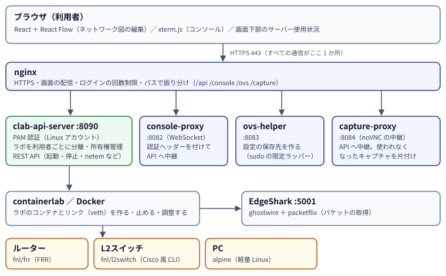

# 操作マニュアル（評価者編）
<!-- subtitle: システムの目的・設計・検証結果と、15 分で確かめる手順 -->

## 1. 要約

**Free-Networking-labs** は、Cisco Modeling Labs（CML）に相当するネットワーク演習環境を、オープンソースの
**containerlab** の上に作ったものです。ブラウザで図を描き、そのまま起動し、ブラウザの中のコンソールで機器を設定できます。

| 観点 | 内容 |
|---|---|
| 解く課題 | CML の無料版は、**単一ユーザー専用**で、**同時に動かせるノードが 5 台まで**。教室や研究室で使いにくい |
| 作ったもの | 共有サーバー 1 台の上で、**複数人が同時に、各自のラボを持てる**、CML 風のブラウザ環境 |
| 特徴 | ① ノード数に上限がない ② 認証は Linux アカウントを使い、独自のユーザー DB を持たない ③ スイッチを Cisco 風の CLI で設定できる（VLAN・STP・EtherChannel など）④ 回線の遅延・ロス・帯域・断線を再現できる ⑤ 画面で Wireshark が使える |
| 規模 | 画面約 7,100 行、スイッチ約 3,600 行などで、開発期間は約 5 週間（2026-09-09〜10-15）。テストは自動 63 件（CI で自動実行）と、手動の手順書 |
| 動作確認 | 実サーバー（4 コア・メモリ 12 GB）で、VLAN・Router on a stick・STP・EtherChannel・OSPF などの演習が通ることを確認 |
| 未了・制約 | 外部ネットワークへの接続、商用ルーターのイメージ、L3 スイッチ、放置ラボの自動停止、サーバー再起動後の復旧の検証は未実施（10 章） |

## 2. 背景と目的

CML は、ネットワークの演習で広く使われるシミュレーターです。無料版（CML Free）は、単一ユーザー専用で、
同時に起動できるノードが 5 台までという制限があります。一方、**containerlab** は Docker の上に軽量にネットワーク機器を
立ち上げられるオープンソースのツールで、YAML でトポロジを定義します。しかし画面（GUI）が弱く、
初心者や、複数人での利用には向いていません。

そこで、**containerlab をバックエンドにして、CML の操作感を持つオープンソースの GUI を作り**、
CML Free の弱点（マルチユーザー、ノード数の上限）を解消することを目的としました。

スコープは次のとおりです。

- **対象**：ルーター（FRR）、L2 スイッチ、PC の 3 種類のノードで、CCNA レベルの演習を行える範囲。
- **対象外**：授業の運営機能（課題の配布や進捗の管理）、外部ネットワークへの接続（CML の External Connector 相当）、
  商用ベンダーのルーターのイメージ。
- **最優先**：GUI の使い勝手（ドラッグ＆ドロップ、状態の可視化、統合コンソール）を作り込む。

## 3. CML Free・containerlab との比較

| 項目 | CML Free | containerlab（公式 GUI を含む） | **本システム** |
|---|---|---|---|
| 利用者 | 単一ユーザー | 単独利用が中心（API サーバー経由で複数人は可） | **複数人が同時に、各自のラボを持てる** |
| 同時に動かせるノード | 5 台まで | 制限なし | **制限なし**（サーバーの資源の範囲） |
| 操作 | ブラウザの GUI | CLI と YAML（GUI は発展途上） | **ブラウザの GUI**（ドラッグ＆ドロップ、自動保存、元に戻す） |
| 認証 | 単一のアカウント | — | **Linux のアカウントをそのまま使用**（独自の DB なし） |
| ノードの種類 | Cisco 等の商用イメージ | 多数（準備の手間が大きい） | FRR（ルーター）、**自作の L2 スイッチ**、PC |
| スイッチの設定 | IOS 系の CLI | — | **Cisco 風の CLI**（VLAN・STP・EtherChannel・ポートセキュリティなど） |
| 回線の障害の再現 | あり（版・ライセンスによる） | netem を手で実行 | **GUI で遅延・ロス・帯域・断線** |
| パケットキャプチャ | あり | EdgeShark 等を手で構築 | **画面から Wireshark** |
| 外部ネットワークへの接続 | あり | あり | なし（対象外） |
| 費用 | 無料版は制限付き | 無料 | 無料（オープンソース） |

!!! note "比較について"
    CML 側の項目は、公式の説明で一般に言われている内容に基づく概略です。商用イメージを使えることなど、
    CML にあって本システムにない機能は、制約として 10 章に書きました。

## 4. 機能一覧

○＝実装して動作を確認、△＝一部・制約あり、×＝未実装。

| 分類 | 機能 | 状態 |
|---|---|---|
| 画面 | ドラッグ＆ドロップでのトポロジ編集（ノード 3 種・線・ラベル・エリア） | ○ |
| | 自動保存、起動中の変更だけを反映（変更していないノードは作り直さない） | ○ |
| | 元に戻す／やり直す（何がどう変わったかを表示） | ○ |
| | ノードの状態表示（起動・停止・処理中）、ダーク／ライト、サーバー使用状況の表示 | ○ |
| | エクスポート／インポート（YAML） | ○ |
| ラボ | 起動・停止・削除、ノード単位の起動・停止、**ノード単位の初期化（wipe）** | ○ |
| コンソール | ブラウザ内のターミナル（複数タブ、ドッキング） | ○ |
| ルーター | FRR（OSPF・BGP・RIP・IS-IS・スタティックなど）、vtysh での設定、サブインターフェース、LLDP/CDP | ○ |
| L2 スイッチ | VLAN（アクセス・トランク・native）、Cisco 風 CLI（省略形・`?`・Tab・エラー位置の `^`） | ○ |
| | **STP / RSTP / MSTP**（portfast・BPDU ガード・ルートガードなど） | ○ |
| | **EtherChannel（LACP）**、ポートセキュリティ、MAC テーブル、管理用 SVI、LLDP/CDP、ログ、パスワード | ○ |
| | PVST、PAgP、DHCP スヌーピング、SPAN | × |
| 回線 | 帯域・遅延・ゆらぎ・ロス・破損の設定、ケーブルの抜き差し | ○ |
| キャプチャ | 画面から Wireshark（ブラウザの中） | ○ |
| 認証・分離 | Linux アカウントでのログイン、ラボの利用者ごとの分離 | ○ |
| 運用 | HTTPS の入口（nginx）、ログインの回数制限、使われないキャプチャの自動片付け | ○ |
| | 放置ラボの自動停止 | ×（保留） |
| | L3 スイッチ、外部ネットワークへの接続、商用イメージ | ×（対象外・将来） |

## 5. システムの構成

利用者のブラウザは、**nginx の 443 番だけ**につなぎます。nginx が用途ごとに裏のサービスへ振り分けます。

| 構成要素 | 役割 |
|---|---|
| **clab-api-server**（既存のオープンソース） | ラボの操作 API。**Linux アカウントで認証（PAM）**し、ラボを `<ユーザー名>/` ごとに分離して管理する |
| **console-proxy**（自作・約 100 行） | ブラウザの WebSocket はヘッダーを付けられないが、API はヘッダーでしか認証しないため、ヘッダーを付けて中継する |
| **ovs-helper**（自作） | ルーター・スイッチの設定の保存先を、ラボの作成前に用意する。root が必要な部分は、sudo の限定ラッパーに閉じ込める |
| **capture-proxy**（自作） | Wireshark の画面（noVNC）の中継と、使われなくなったキャプチャの片付け |
| **fnl/frr**（自作のイメージ） | FRR に、サブインターフェースの自動作成と LLDP/CDP を足したもの |
| **fnl/l2switch**（自作のイメージ） | Linux ブリッジ＋ Cisco 風 CLI ＋ STP（mstpd を改修）＋ lldpd |

### 技術の選定

| 領域 | 採用 | 理由 |
|---|---|---|
| 画面 | React ＋ React Flow | ノード 1 つ 1 つに、状態の表示やボタンなどを自由に載せられる。Cytoscape.js は自動レイアウトが強いが、手動配置が主の本件には過剰 |
| コンソール | xterm.js ＋ WebSocket | ブラウザ内ターミナルの定番 |
| 状態管理 | Zustand | 規模に対して Redux は過剰 |
| バックエンド | clab-api-server（既存） | 認証とラボの分離を一から作ると、GUI の開発時間が削られる |
| ルーター | FRR | コンテナでそのまま動き、軽量。OSPF・BGP などが一通り使える |

## 6. 設計上の主な判断

| 判断 | 理由 | 結果 |
|---|---|---|
| 認証は **Linux アカウント**（PAM）に任せる | 独自のユーザー DB を作ると、ラボの分離まで自作することになる | アカウントを作るだけで、各自が自分のラボを持てる |
| ノード数の**上限を設けない** | 実測で、ルーター 1 台が約 40 MB、PC が数 MB と軽い | CML Free との差別化になる。混み具合は画面下部で見える |
| **L2 スイッチを自作**（当初の OVS をやめ、コンテナの Linux ブリッジに変更） | OVS はホスト全体に作用して、ブリッジの名前が衝突し、差分反映（`apply`）にも対応できない。コンテナなら、ラボごとに独立する | 他の利用者と衝突せず、設定の保存・復元も、ノード単位でできる |
| **自動保存＋差分反映**（Deploy ボタンを廃止） | CML と同じ操作感にしたい。起動中の編集で、変更のないノードの設定を壊したくない | 変更した部分だけが反映される |
| ルーターの設定は **`write memory` で保存**（自動保存しない） | 実機の電源断と同じ運用にして、設定の保存を意識させる（学習のため） | 保存した設定は、停止→起動でも残る |
| ノードは**特権なし**で動かす | `privileged` のままだと、コンソールから、ホストへの侵害を試みられる | 必要最小限の権限（`NET_ADMIN` など）に絞った |
| STP は **mstpd を改修して**使う | 自前で STP を実装するのは非現実的。ただし mstpd はコンテナ内では動かない | 3 つのモード（STP・RSTP・MSTP）が動く（7.1） |
| ラボの ID の先頭に**ユーザー名**を付ける | コンテナ名はサーバー全体で 1 つしか使えず、別の利用者と同じ名前のラボを作ると起動できなかった | 利用者どうしで衝突しない |

## 7. 技術的な工夫

### 7.1 L2 スイッチ（Linux ブリッジ＋ Cisco 風 CLI ＋ STP）

商用のスイッチのイメージは使えないため、**Linux のブリッジ（VLAN 対応）をスイッチとして使い、その上に
Cisco 風の CLI（swcli、Python）を載せました**。CLI は、設定を保存したファイルを、エージェントが 1 秒ごとにブリッジに
反映します。

- **Cisco らしい操作感**：省略形（`conf t`、`sw mo acc`）、`?` での候補、Tab での補完、間違えた位置を示す `^`、
  `do show ...`、`| include` による絞り込み。
- **STP（802.1D / 802.1w / 802.1s）**：mstpd を使いますが、そのままではコンテナの中で動きません。原因は、
  カーネルのユーザー STP モードがホストの名前空間でしか使えないことです。そこで、①カーネルの STP は切り、②mstpd が
  決めたポートの状態を、カーネルの **MST のポート状態**として入れ、③ BPDU はポートの入口で捨てて、mstpd には手前で
  受け取らせる、という改修を行いました（パッチ 5 か所）。また、非特権のコンテナで mstpd が応答できない不具合
  （ソケットの制御メッセージが原因）も見つけて直しました。
- **EtherChannel**：Linux の bond（LACP・固定）に対応づけ、Cisco と同じ表示（`Po1(SU)`、`eth2(P)`）にしました。
- **ポートセキュリティ**：ブリッジポートの `locked` と `mab` を使い、知らない MAC を、上限以内なら固定の
  エントリにして通し、超えたら違反（protect・restrict・shutdown）として扱います。
- **LLDP/CDP**：lldpd で、スイッチとルーターが互いに見えます（CDP は既定で有効、LLDP は無効 — Cisco と同じ）。

### 7.2 自動保存と、差分だけの反映

containerlab の `apply`（既存のラボとの差分だけを反映する機能）を使い、**起動中に図を編集しても、変更した
ノードだけが作り直されるようにしました**。コンテナの中の設定（PC のアドレスなど）は、トポロジの定義に含まれないので、
ノードごとに「あるべき状態」を作る 1 本のコマンドを作り、前回と違うノードにだけ流します（何度流しても同じ結果になる）。

### 7.3 回線の品質（netem）とケーブルの抜き差し

Linux の `tc netem` を、API 経由で線の両端に設定します。帯域の既定は 100 Mbps です（CML は 10 Mbps）。
API は、同じラボへの同時の操作を断るため、**順番に実行して、混んでいれば再試行する**ようにしました。
ケーブルの抜き差しは、スイッチ側のポートを `notconnect` にして再現します（`shutdown` の `disabled` とは区別）。

### 7.4 利用者の分離とセキュリティ

- 認証は PAM、ラボの分離は API サーバーが担います。**ラボの ID にユーザー名を付ける**ことで、コンテナ名の衝突も防ぎます。
- ノードは**特権なし＋最小限の権限**で動かします（DockerのAppArmor・seccompが有効）。
- ホストの管理操作が必要な部分（設定の保存先の作成）は、**sudo の限定ラッパー**に閉じ込めます。入力の形式を検査し、
  シンボリックリンクを拒否し、既存のファイルを上書きしません。
- プロキシは **127.0.0.1 だけ**で待ち受け、外に出すのは nginx の 443 番だけです。ログインには回数制限があります。
- 詳しい点検の結果は、`docs/security.md` にあります。

### 7.5 パケットキャプチャ

EdgeShark（ホストのコンテナのネットワークを見る仕組み）で取得し、Wireshark の画面を noVNC で、ブラウザのタブに出します。
タブごとに「R1(eth1) ↔ SW1」のような名前を付け、**タブを閉じたら（またはメイン画面を閉じても）60 秒で、
サーバー側が自動で片付けます**。

### 7.6 ノードの初期化（wipe）

API の新しい版で、従来の方法（ノードだけを `reconfigure` で作り直す）が、**ノードが消えたまま残る**不具合になることを
確認しました。そこで、「そのノードを除いたトポロジを `apply`（ノードと線が消える）→ 元に戻して `apply`（作り直される）」
という 2 段階に変え、さらに、隣のノードの設定が消える影響（つながっていた veth が作り直されるため）も流し直すようにしました。

## 8. 検証

### 8.1 自動テスト

| 対象 | 内容 | 件数 |
|---|---|---|
| 画面（vitest） | トポロジ⇔ YAML の変換、保存と読み込みの往復、ノードごとの設定コマンド（シェルに渡る値の検証を含む）、リンクの品質、ラボの名前、wipe | 45 |
| スイッチの CLI（unittest） | コマンドの解釈、パスワード（Cisco の type 7 と 9）、running-config の流し込み直し、`write memory` | 15 |
| 静的チェック | 型（tsc）、lint、pyflakes、プロキシの構文 | — |

これらは、GitHub Actions で、**プッシュとプルリクエストのたびに自動で動きます**。過去に実際に起きた不具合
（イメージのタグを上げたら、古いルーターが PC と判定された）を、テストが検出することを確かめています。

### 8.2 手動の動作確認

実機（サーバー）で、機能ごとの手順書（`docs/test-manual.md`）に沿って確認しました。この手順書は、
機能を追加するたびに更新しています。

### 8.3 実測

| 項目 | 結果 |
|---|---|
| RSTP の切り替え | 経路のポートを `shutdown` しても、0.2 秒間隔の ping が **1 つも欠けない** |
| 古典 STP の切り替え | ルート側のリンク断から **約 49 秒**で迂回（RSTP との差を体験できる） |
| STP なしのループ | 1 ポートあたり**毎秒約 29 万パケットのストーム**。サーバーの load average が 0.5 → 3 に上がる（そのため STP を既定で有効にした） |
| EtherChannel | メンバーのケーブルを抜いても、通信は止まらない（損失 0%） |
| ケーブルを抜いたときの PC のポート | portfast なしで約 12 秒、あれば 0 |
| スイッチのエージェントの CPU | 1 台あたり約 1% |
| ルーターの確認処理の CPU | 1 台あたり約 1.2%（2.5% から 2 秒間隔に変更して半減） |
| 通信の CPU | 100 Mbps の制限で、通信 1 本あたり約 3%。制限なしだと約 44% |
| メモリ | PC 約 1〜3 MB、ルーター約 40〜45 MB、スイッチ約 20〜100 MB（キャッシュを含む） |

## 9. 開発の進め方と規模

| 項目 | 内容 |
|---|---|
| 体制 | バックエンド・インフラ担当と、フロントエンド担当の 2 名。AI の開発支援（Claude Code）を、設計の相談・実装・テスト・文書で使用 |
| 期間 | 2026-09-09〜10-15（約 5 週間） |
| ブランチ運用 | main は直接変更を禁止し、**プルリクエスト（27 件以上）**を通して変更。決定事項は `docs/direction.md` に日付つきで記録 |
| 規模 | 画面 約 7,100 行、スイッチ（Python など）約 3,600 行、プロキシ・nginx など約 900 行、文書約 2,500 行 |
| 記録 | 決定事項の履歴（`docs/direction.md`）、進捗（`docs/STATUS.md`）、API の仕様（`docs/api-contract.md`）、セキュリティの点検（`docs/security.md`） |

実機で見つかった問題と、その対処を、記録に残しています。たとえば、ブラウザの WebSocket がヘッダーを付けられない問題
（console-proxy を作った）、Linux のインターフェース名が 15 文字までという制限（ブリッジ名の設計を変えた）、
非特権コンテナで STP が動かない問題（mstpd の改修）、API の新しい版でノードの作り直しが壊れる問題（wipe の方式変更）などです。

## 10. 制約と今後

| 分類 | 内容 |
|---|---|
| 対象外 | 外部ネットワークへの接続、商用ルーターのイメージ（vrnetlab などでの対応は準備のコストが大きい）、授業の運営機能 |
| スイッチの制約 | PVST（Cisco 独自の VLAN ごとの STP）、PAgP、DHCP スヌーピング、SPAN は未対応。L3 スイッチは将来の拡張候補 |
| 運用 | **放置ラボの自動停止は未実装**（「放置」の定義と、止める前の通知の方針が決まっていないため保留）。サーバーの再起動後に、ラボが正しく戻るかは**未検証**。HTTPS は自己署名の証明書で、初回に警告が出る |
| 資源 | 全員が大きなラボを同時に動かすと、メモリ（12 GB）を超える。ラボの規模の目安と、使い終わったら停止する運用で対応する |
| 将来 | 放置ラボの自動停止とメモリ不足時の警告、画面のコンポーネントの自動テスト、キャプチャのフィルタ指定、L3 スイッチ、ノードのイメージの選択 |

## 11. 15 分で確かめる手順（評価者向け）

用意：管理者から受け取った URL とアカウント。ブラウザは Chrome か Edge。

| 時間 | 操作 | 見てほしい点 |
|---|---|---|
| 0:00 | ログインし、「＋ 新規ラボを作成」。PC を 2 台、L2 スイッチを 1 台、ルーターを 1 台、ドラッグして線でつなぐ | ドラッグ＆ドロップ、自動保存、接続ダイアログ |
| 3:00 | 「▶ 起動」。ノードのランプが緑になるのを確認 | 起動の速さと状態の可視化 |
| 4:00 | スイッチのコンソールを開き、`conf t` → `vlan 10` → `int eth1` → `sw mo acc` → `sw acc vl 10` | Cisco と同じ操作感（`?`、Tab、省略形、エラーの `^`） |
| 6:00 | PC のコンソールで `ping`。VLAN の違うポートでは通らないことを確認 | 実際に動く |
| 8:00 | 線を右クリック →「リンクの品質...」で遅延 50 ms。`ping` の往復時間を見る | 回線の障害の再現 |
| 9:00 | スイッチを 2 台つないでループを作り、`show spanning-tree`。線を右クリック →「ケーブルを抜く」 | STP の動きと迂回 |
| 11:00 | 線を右クリック →「パケットキャプチャ」 | ブラウザの中の Wireshark |
| 13:00 | （アカウントが 2 つあれば）別のブラウザで別のアカウントでログイン | ラボが分かれている（他人のラボは見えない） |
| 14:00 | 「■ 停止」と「削除」で片付ける | ライフサイクル管理 |

操作のくわしい手順は「操作マニュアル（利用者編）」、サーバーの構築と運用は「操作マニュアル（管理者編）」を見てください。

## 付録　用語

| 用語 | 意味 |
|---|---|
| CML（Cisco Modeling Labs） | Cisco のネットワークシミュレーター。無料版は単一ユーザー・5 ノードまで |
| containerlab | Docker の上に、ネットワーク機器のコンテナと線を作るオープンソースのツール |
| FRR | オープンソースのルーティング・ソフトウェア（OSPF・BGP など） |
| STP / RSTP / MSTP | スイッチのループを防ぐ仕組み（802.1D / 802.1w / 802.1s） |
| netem | Linux で、遅延・ロス・帯域を人為的に作る機能 |
| PAM | Linux のアカウントで認証する仕組み |
| WebSocket | ブラウザとサーバーの双方向の通信（コンソールで使う） |
| noVNC | ブラウザの中でリモートの画面を見る仕組み（Wireshark の表示に使う） |
